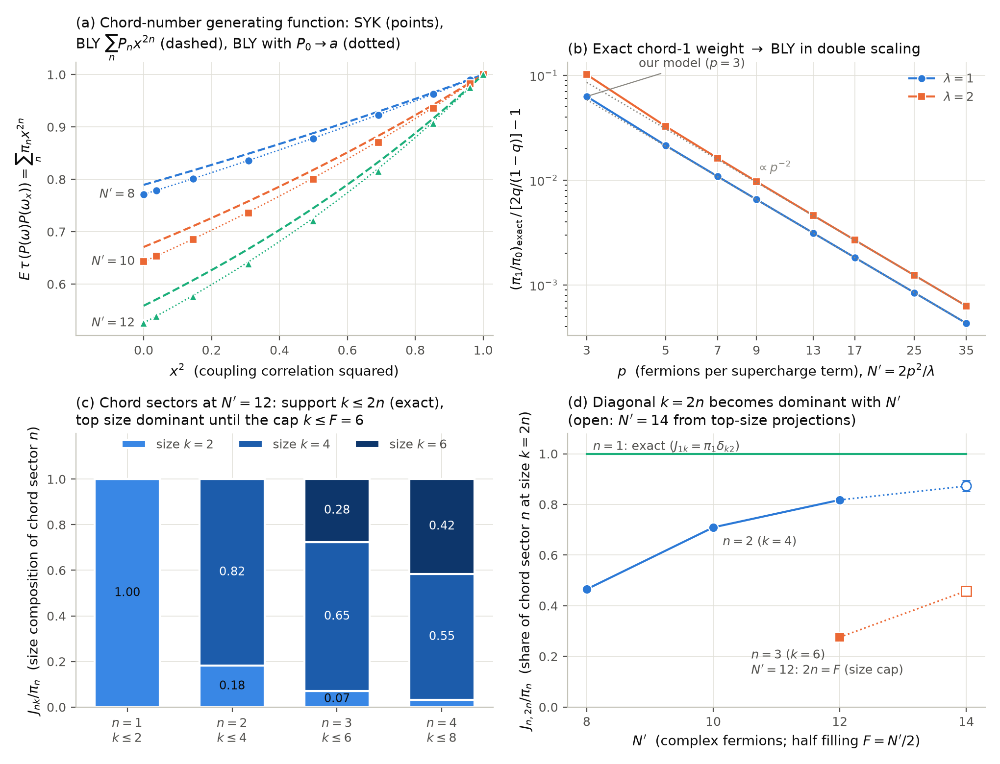

# Chord number and operator size of the BPS projector: an exact finite-$N$ dictionary

*Research note, 2 October 2026. It addresses action item 1 of `research/pdfs/progress_2026-09-29.pdf` §7.3:
"Derive $n\leftrightarrow k/2$: relate super-chord number to operator size, using the operator-size content of BLY's
$n_O, n_X$". It supersedes the conjectural part of `docs/derivations.md` D3. The summary entry is D4. Code, data and
commands are listed in §9.*

**Tags.**
- **[lit]**: stated in a cited paper.
- **[derived]**: proved here.
- **[derived+verified]**: proved here and checked numerically.
- **[numerical]**: measured.
- **[interp]**: interpretation.
- **[conj]**: conjecture.



**Figure 1.**
- **(a)** Chord-number generating function $E\,\tau\big(P(\omega)P(\omega_x)\big)=\sum_n\pi_n x^{2n}$ of one-flavor
  $\mathcal N=2$ SYK, $p=3$, half filling. Points: angle-rotated OU pairs, error bars smaller than the markers. Dashed:
  BLY's $\sum_n P_nx^{2n}$ at $\lambda=2p^2/N'$. Dotted: the same with $P_0$ replaced by the exact $a$.
- **(b)** The exact chord-1 weight $\pi_1/\pi_0$ (closed form, §4) relative to BLY's $2q/(1-q)$. It converges as
  $p\to\infty$ at fixed $\lambda$, with corrections $\propto p^{-2}$.
- **(c)** Size composition $J_{nk}/\pi_n$ of each chord sector at $N'=12$. The support $k\le 2n$ is exact (§3).
- **(d)** Share of chord sector $n$ at the top size $k=2n$. Filled points: OU fits. Open points ($N'=14$): top-size
  projections (lower bounds, §6.3) with a band from the Krylov estimate of $\pi_n$.

---

## 0. Summary

1. **[derived+verified] The exact finite-$N$ chord number is a Wiener-chaos (Wick) degree.**
   - The BPS projector $P(\omega)$ is a function of the Gaussian couplings $\omega$. Its chaos components $P_{[n]}$ have
     bidegree $(n,n)$.
   - For couplings correlated as $\omega_x=x\,\omega+\sqrt{1-x^2}\,\omega'$, $E\,\tau(P(\omega)P(\omega_x))=\sum_n\pi_nx^{2n}$
     with $\pi_n=E\|P_{[n]}\|^2/d$. Each Wick contraction across the cut carries $x$.
   - This is BLY's two-point function (4.5) with $q^\Delta\to x$, so $\pi_n$ is the exact counterpart of BLY's
     chord-number distribution $P_n$.
   - Checks: $\pi_0=a$ exactly; BLY's $P_0=a_\lambda$ is its double-scaled value. $\pi_1$ has a closed form that
     tends to BLY's $P_1$ in double scaling. The measured generating function reproduces BLY's shape once $P_0\to a$
     (Fig. 1a).

2. **[derived] Joint (chord, size) distribution.** The chaos grading commutes with $U(N)$. So
   $J_{nk}=E\|P^{(k)}_{[n]}\|^2/d$ exists, with marginals $\pi_n$ (chord) and $w_k$ (size).

3. **[derived+verified] Selection rule: size is bounded by chord number.** $J_{nk}=0$ unless $k\le n(p-1)+1$. At half
   filling, $k\le n(p-1)$; for $p=3$, $k\le 2n$.
   - It follows from the plethysm $\mathrm{Sym}^n\Lambda^p$ for odd $p$, the representation-theoretic form of $Q^2=0$,
     plus particle–hole parity.
   - It is the finite-$p$ correction of BLY eq. (5.23), $\mathrm{size}_O=p\,n_O$.
   - Verified: $J_{1,4}=0$ at all $N'$. At $N'=12$, $J_{2,6}=0.0000(1)$ while $J_{3,6}=0.0077$.
   - The general bound is attained away from half filling: $J_{1,3}=0.0035$ at $N'=9$, 279σ from zero.

4. **[derived+verified] Exact low sectors ($p=3$, half filling).**
   - $J_{0k}=a\,\delta_{k0}$.
   - $J_{1k}=\pi_1\delta_{k2}$, with $\pi_1/\pi_0=m_1^2/\big(m_2-(1+M^{-1})m_1^2\big)$ and $m_k=E\,\mathrm{tr}H^k$.
   - The ratio equals $7/27,\ 24/55,\ 220/351,\ 52/63$ at $N'=8,10,12,14$, and tends to $2q/(1-q)$ as $p\to\infty$.

5. **[derived] Krylov form.**
   - $\kappa_n=a\,p_n(0)^2$ exactly, where $p_n$ are the orthonormal polynomials of the disorder-averaged density of
     states.
   - In BLY at $j_R=0$, $P_n=a_\lambda\,p_n^{\rm DS}(0)^2$ exactly.
   - **[numerical]** $\kappa_n\approx\pi_n$: equal for $n=0$, to $O(1/M)$ for $n=1$, within 3% for $n=2$ and about 10%
     for $n=3$.

6. **[numerical] Diagonal dominance for $n\ge2$.** The share of chord sector 2 at $k=4$ is 0.47, 0.71, 0.82 and about
   0.87 at $N'=8,10,12,14$. Chord sector 3 is limited by the size cap $k\le F$: 0.28 at $N'=12$, about 0.45 at
   $N'=14$.
   - The top-size part of chord sector $n$ lies along $(H^n)^{(2n)}$. This gives a rigorous lower bound on
     $J_{n,2n}$, saturated to 1% ($n=2$) and about 5% ($n=3$).

7. **[derived] The decoder probe sees size, not chord number.**
   - The chord-1 sector is weighted by the character $\hat\chi_2(U)$, not by the chord rule's $x^2=q^{2\Delta}$: 0.505
     vs 0.424 at $N'=14$.
   - Friend chords share a mode, and the probe's sign cancels on it.
   - BLY's 2% agreement with the decoder variance is partly a compensation: at $N'=14$ its $n=0$ term is $+0.034$ too
     high and its $n=1$ term $-0.028$ too low.

---

## 1. Setup and definitions

**Model.**
- One-flavor $\mathcal N=2$ SYK on $N\equiv N'$ complex fermions.
- Supercharge $Q=\sum_{|I|=p}C_I\psi_I$ with $p$ odd ($p=3$ unless stated).
- $H=\{Q,Q^\dagger\}$ on the charge sector $\Lambda^F$, with $D=\binom NF$ and half filling $F=N/2$ unless stated.
- The couplings $\omega=(C_I)\in W=\Lambda^p\mathbb C^N$, $M=\dim W=\binom Np$, are i.i.d. complex Gaussians. In the
  code $E|C_I|^2=2$; all results are independent of this normalization.
- $P(\omega)$ is the BPS projector, $d=\mathrm{Tr}P$, $a=d/D$, $\tau=\mathrm{Tr}/d$.
- Observed: $d=2\cdot3^{N/2-1}$ at $p=3$, $N'=8$–14.

**Equivariance [derived].** $P(g\omega)=\rho(g)P(\omega)\rho(g)^\dagger$ for $g\in U(N)$, acting on $W$ through
$\Lambda^pg$. Also $P(e^{i\theta}\omega)=P(\omega)$. (Progress report §3.1.)

**Size [derived, progress report §3.2].**
- $\mathrm{End}(\Lambda^F)=\bigoplus_{k=0}^{\min(F,N-F)}V_k$. $V_k$ carries the traceless $k$-body operators, with
  highest weight $(1^k,0,\dots,0,(-1)^k)$ and adjoint Casimir eigenvalue $2k(N+1-k)$.
- $X^{(k)}$ is the $V_k$ component of $X$, and $w_k=\|P^{(k)}\|^2/d$.

**Chord number [derived].**
- $L^2(W,\gamma)\otimes\mathrm{End}(\Lambda^F)$ (Gaussian measure $\gamma$, inner product $E\,\mathrm{Tr}(X^\dagger Y)$)
  decomposes into Wiener chaoses $\mathcal H_{n_1,n_2}$. These are spanned by Wick monomials
  $:\!C_{I_1}\cdots C_{I_{n_1}}\bar C_{J_1}\cdots\bar C_{J_{n_2}}\!:$, and as $U(N)$-representations
  $\mathcal H_{n_1,n_2}\simeq\mathrm{Sym}^{n_1}W^*\otimes\mathrm{Sym}^{n_2}\bar W^*$.
- Phase invariance of $P$ kills $n_1\ne n_2$. So $P=\sum_nP_{[n]}$, and we define the **chord number** as the chaos
  degree $n$:
$$\pi_n=\frac{E\|P_{[n]}\|_F^2}{d},\qquad\sum_n\pi_n=E\,\tau(P^2)=1.$$

**Joint distribution [derived].**
- $U(N)$ acts unitarily on $W$, so it preserves $\gamma$ and commutes with the chaos projections.
- The size projections also commute with $U(N)$. So the two gradings commute and
$$J_{nk}=\frac{E\|P_{[n]}^{(k)}\|^2}{d},\qquad \sum_kJ_{nk}=\pi_n,\qquad\sum_nJ_{nk}=w_k .$$
- Moreover $P_{[n]}^{(k)}\in(\mathcal H_{n,n}\otimes V_k)^{U(N)}$, the invariant subspace.

**Krylov distribution.** $\kappa_n=\langle p_n(H),P\rangle^2/\|P\|^2$ in the averaged inner product, where $p_n$ are the
orthonormal polynomials of the averaged spectral measure $\mu(E)=E\,\mathrm{tr}\,\delta(E-H)$ (§5).

## 2. The chord number is the Wiener-chaos degree

**Mehler formula [derived].** Let $\omega_x=x\,\omega+\sqrt{1-x^2}\,\omega'$ with $\omega'$ an independent copy and
$x\in[-1,1]$. The Ornstein–Uhlenbeck semigroup $T_xf(\omega)=E_{\omega'}f(\omega_x)$ acts on
$\mathcal H_{n_1,n_2}$ as $x^{n_1+n_2}$. Hence
$$G(x)\equiv E\,\tau\big(P(\omega)P(\omega_x)\big)=\sum_{n}\pi_n\,x^{2n},\qquad
\frac{E\langle P^{(k)}(\omega),P(\omega_x)\rangle}{d}=\sum_nJ_{nk}\,x^{2n}. \tag{2.1}$$

**Chord-diagram reading [derived].**
- Expand both projectors as $\lim_{\beta\to\infty}e^{-\beta H}$ and Wick-contract. The jointly Gaussian pair has
  $E[C_I\bar C'_J]\propto x\,\delta_{IJ}$, so each contraction joining the two copies carries $x$. Internal
  contractions carry 1.
- The coefficient of $x^{2n}$ collects the diagrams with $n$ $Q$-chords and $n$ $Q^\dagger$-chords crossing the cut.
  These are exactly the chords counted by BLY's chord number (their eqs. 2.4–2.5: $n$ XO pairs) **[lit]**.
- In BLY, a horizontal matter chord gives $q^\Delta$ per crossing, so their (4.5)–(4.6) is $\sum_nP_nq^{2\Delta n}$.
  (2.1) is the same sum with $q^\Delta\to x$, evaluated with exact finite-$N$ Wick weights instead of double-scaled chord
  rules. So $\pi_n\to P_n$ in the double-scaled limit **[derived]**. This is checked analytically for $n=0,1$ (below
  and §4) and numerically in Fig. 1a.
- The OU pair is therefore an exact finite-$N$ realization of the rule "weight $x$ per chord crossing the cut".
- Unlike the decoder probe (§7), it needs no factorization assumption.

**$n=0$ [derived].** $P_{[0]}=E[P]=a\mathbb 1$ by Schur's lemma, so $\pi_0=w_0=J_{00}=a$ exactly. This is the exact
finite-$N$ form of BLY's "probability of zero length = BPS fraction" (their eqs. 1.1, 3.15 **[lit]**), with the exact
$a$ in place of the double-scaled $a_\lambda=D(j_R)$.

**Comparison with BLY [numerical]** (Fig. 1a). The measured $G$ lies below BLY's $\sum_nP_nx^{2n}$, by the normalization
$a<a_\lambda$. After replacing $P_0$ by the exact $a$ and rescaling the rest, the conditional shapes
$\pi_n/(1-a)$ and $P_n/(1-P_0)$ agree to 1–2% ($N'=8$), 2–3% ($N'=10$) and 3–6% ($N'=12$) across the $x$ range.

## 3. Selection rule: size $\le(p-1)\times$ chord number

**Proposition [derived+verified].** For odd $p$, $P_{[n]}^{(k)}=0$ unless $k\le n(p-1)+1$. At half filling ($N=2F$),
$P_{[n]}^{(k)}=0$ unless $k\le n(p-1)$. For $p=3$ the joint distribution is supported on $k\le 2n$.

**Proof.**

1. $P_{[n]}^{(k)}$ is an invariant vector in $\mathcal H_{n,n}\otimes V_k$. It can be nonzero only if the self-dual
   irrep $V_k$ occurs in $\mathrm{Sym}^nW\otimes\overline{\mathrm{Sym}^nW}$.
2. Write $\mathrm{Sym}^n\Lambda^p=\bigoplus_\mu a_\mu V_\mu$, where $a_\mu$ are the plethysm coefficients of
   $h_n[e_p]$.
3. In the stable range $N\ge\ell(\mu)+\ell(\nu)$, the mixed tensor product
   $V_\mu\otimes\overline{V_\nu}=\bigoplus_{\alpha,\beta}\big(\sum_\gamma c^\mu_{\alpha\gamma}c^\nu_{\beta\gamma}\big)[\alpha;\beta]$
   (Koike 1989, not in `papers/`).
   - $V_k=[1^k;1^k]$ therefore requires $c^\mu_{(1^k)\gamma}\neq0$, i.e. $\mu/\gamma$ a vertical $k$-strip.
   - So $k\le\ell(\mu)$.
   - The bound is non-trivial only if $n(p-1)+1<\min(F,N-F)\le N/2$. That case is automatically inside the stable range,
     since $\ell(\mu),\ell(\nu)\le n(p-1)+1$ (step 4). When the bound exceeds $\min(F,N-F)$, it is implied by $k\le F$.
4. For odd $p$, $h_n[e_p]=\omega\big(e_n[h_p]\big)$ (Macdonald, *Symmetric Functions*, Ch. I §8).
   - A highest-weight vector of $\Lambda^n(\mathrm{Sym}^pV)$ is a wedge of $n$ distinct degree-$p$ monomials. Its first
     row is at most $p+(n-1)(p-1)$: one monomial $x_1^p$, the rest $x_1^{p-1}x_j$.
   - That value is attained by $x_1^p\wedge x_1^{p-1}x_2\wedge\cdots\wedge x_1^{p-1}x_n$, a highest-weight vector.
   - Transposing: $\max_\mu\ell(\mu)=n(p-1)+1$.
   - Checked by explicit Schur expansion (`scripts/check_plethysm_rows.py`):
     $h_2[e_3]=s_{222}+s_{21^4}$ (5 rows); $h_3[e_3]=s_{333}+s_{32211}+s_{31^6}+s_{2221^3}$ (7 rows);
     $h_2[e_5]$ has at most 9 rows.
5. At half filling, particle–hole conjugation forces $P^{(k)}=0$ for odd $k$.
   - Progress report §4.4: sketch, signs not tracked.
   - Here, verified per realization: the even-size decomposition of $P$ has residual $\le10^{-16}$ at $N'=8$–14.
   - The chaos projection is linear and pointwise in $\mathrm{End}$, so each $P_{[n]}$ has only even sizes.
   - Since $n(p-1)+1$ is odd, $k\le n(p-1)$. $\square$

**Interpretation [interp].**
- The couplings commute, so the $n$ $Q$-chords crossing the cut carry a *symmetric* tensor of index sets. For odd $p$,
  however, the operators $\psi_I$ anticommute ($Q^n=0$).
- $\mathrm{Sym}^n$ of fermionic (odd-$p$) index sets is the transpose of $\Lambda^n$ of bosonic ones (the
  $\omega$-involution of step 4). Configurations in which the chords touch pairwise-disjoint modes cancel, and at least
  $n-1$ coincidences among the $n$ chords' modes are forced. In BLY's language, consecutive chords are friends.
- This leaves at most $n(p-1)+1$ distinct modes. The maximal shape $(n,1^{n(p-1)})$ is $n$ chords sharing a single
  "hub" mode.
- At $j_R=0$ the C-symmetric Hartle–Hawking state removes one more unit.

**Relation to BLY (5.20)–(5.23) [lit + derived].**
- BLY identify $n_O=\mathrm{size}_O/p$, with $\mathrm{size}_O$ the number of $\psi$'s in a fermion-string basis. This is
  correct at leading order in $1/p$.
- The finite-$p$ statement for the BPS state is $k\le(p-1)n$: one unit of size per chord pair is lost to the shared
  (friend) mode.
- For $n=1$ this is visible directly. $\{\psi_I,\psi_J^\dagger\}=0$ if $I\cap J=\emptyset$ (odd $p$), and if
  $I\cap J=\{s\}$ it equals $\pm\psi_{I\setminus s}\psi_{J\setminus s}^\dagger$: the shared mode drops out through
  $\psi_s\psi_s^\dagger+\psi_s^\dagger\psi_s=1$.
- Hence $H$ has no size-$p$ part at any filling. This is the rigorous form of D3 step 1, by Schur: the $V_p$ isotypic
  part of $\Lambda^p\otimes\overline{\Lambda^p}$ is spanned by translates of $|I\rangle\langle J|$ with disjoint $I,J$,
  which map to zero.

**The general bound is attained off half filling [numerical].**
- At $N'=9$, $F=4$ (no particle–hole symmetry), the chord-1 sector carries
  $J_{1,1}=0.01876$, $J_{1,2}=0.24211$ and $J_{1,3}=0.00349$. The size-3 overlap is 279σ from zero.
- So for $P$ (unlike for $H$), size $p$ does occur at $n=1$ when $j_R\neq0$. It is generated by contractions inside
  $H^m$, $m\ge2$.
- In BLY's terms, the HH state at $j_R\ne0$ has $\alpha_n\neq\beta_n$, i.e. a C-odd XO$-$OX admixture.
  Microscopically that is $(Q^\dagger Q)^n-(QQ^\dagger)^n$, which can carry the top size.

## 4. Exact low sectors ($p=3$, half filling)

**$n=1$ [derived+verified].**
- The chaos-1 space is $\mathcal H_{1,1}\simeq\Lambda^3\otimes\overline{\Lambda^3}=\bigoplus_{r=0}^3V_r$, each irrep
  once. So the invariant subspace at each size $r$ is one-dimensional.
- $r=0$ is excluded because $P^{(0)}=a\mathbb 1$ has no fluctuation; $r=1,3$ are excluded by parity.
- $H^{(2)}$, the size-2 part of $H$, is a pure chaos-1 invariant vector: $H$ is bilinear in $(\omega,\bar\omega)$ and
  $E[H]$ is a scalar. So
$$P_{[1]}=\gamma\,H^{(2)}\quad\text{exactly},\qquad J_{1k}=\pi_1\,\delta_{k2}.$$
- **The coefficient.**
  - $PH=0$, and $H$ has sizes $\{0,2\}$ only (verified).
  - So $\langle P,H^{(2)}\rangle=-\langle P^{(0)},H^{(0)}\rangle=-d\,\mathrm{Tr}H/D$, per realization.
  - Hence $\gamma=-d\,(E\,\mathrm{Tr}H/D)/E\|H^{(2)}\|^2$.
  - Using $\mathrm{Tr}H=c|\omega|^2$ and $E|\omega|^4=(E|\omega|^2)^2(1+M^{-1})$:
$$\boxed{\frac{\pi_1}{\pi_0}=\frac{m_1^2}{m_2-(1+M^{-1})\,m_1^2},\qquad m_k=E\,\mathrm{tr}H^k}\tag{4.1}$$
  - In words: mean energy squared over energy variance in the sector. Explicitly,
    $m_2/m_1^2-1=\frac{M}{D\,h_0^2}\sum_{m=1}^{p}\binom pm\binom{N-p}{p-m}\big[\binom{N-2p+m}{F-p+m}+\binom{N-2p+m}{F-p}\big]$
    with $h_0=\binom Fp+\binom{N-F}p$. The bracket is $\|\{\psi_I,\psi_J^\dagger\}\|_F^2$ for $|I\cap J|=m$.
- **Independent check.** The chaos-$(1,0)$ projection of $QP=0$ gives $\sum_I\psi_I\Gamma_{JI}=-a\psi_J$. It fixes
  $\gamma=-a/\big[\binom{N-F+p}p-\binom{N-F}p-c/D\big]$, identical to the above (checked at $N'=14$ with unit
  coupling variance: $\gamma=-5.009\times10^{-3}$ both ways; $\gamma\propto1/E|C|^2$). This is the first step of a finite-$N$ version of BLY's HH recursion
  (3.2)–(3.3).

| $N'$ | $m_2/m_1^2-1$ | $\pi_1/\pi_0$ (4.1) | BLY $2q/(1-q)$ | $\pi_1$ | BLY $P_1$ | $w_2$ | measured $J_{1,2}$ |
|---|---|---|---|---|---|---|---|
| 8 | 31/8 | 7/27 = 0.2593 | 0.2356 | 0.2000 | 0.1860 | 0.2147 | 0.2002(2) |
| 10 | 23/10 | 24/55 = 0.4364 | 0.3961 | 0.2805 | 0.2657 | 0.3004 | 0.2805(3) |
| 12 | 8/5 | 220/351 = 0.6268 | 0.5744 | 0.3297 | 0.3209 | 0.3510 | 0.3299(5) |
| 14 | 17/14 | 52/63 = 0.8254 | 0.7642 | 0.3506 | 0.3506 | 0.3706 | — |

Notes on the table:
- $w_2$: ensemble averages of this campaign for $N'\le12$; $N'=14$ from progress-report Table 2.
- Measured $J_{1,2}$: free fits of (2.1), §6.
- The OU data independently confirm $P_{[1]}=\gamma H^{(2)}$. After subtracting $a\mathbb 1+\gamma H^{(2)}$, the
  remainder has no $x^2$ term: $\tilde\pi_1=0.0001(2)$ at $N'=8$.
- Since $J_{1k}=\pi_1\delta_{k2}$, $w_2-\pi_1=\sum_{n\ge2}J_{n2}\ge0$ exactly. It is the leakage of higher chord
  sectors into size 2: 0.015, 0.020, 0.021, 0.020 at $N'=8$–14.

**Double-scaled limit [derived+verified].**
- With $N\to\infty$, $p\to\infty$, $\lambda=2p^2/N$ fixed:
  - $|I\cap J|$ is Poisson($\lambda/2$);
  - $\binom{N-2p+m}{F-p+m}/\binom NF\to2^{-(2p-m)}$;
  - $\binom Fp/\binom Np\to2^{-p}e^{-\lambda/4}$.
- Hence $m_2/m_1^2-1\to\frac{\sinh(\lambda/2)}{e^{-\lambda/2}}=\frac{1-q}{2q}$ and $1/M\to0$, so
$$\frac{\pi_1}{\pi_0}\ \longrightarrow\ \frac{2q}{1-q}.$$
- This is exactly BLY's $P_1/P_0$ from their (3.6)–(3.10) at $j_R=0$: $\alpha_1^2=q^2/(1-q)^2$, and
  $P_1/P_0=2\alpha_1^2(q^{-1}-1)$.
- Numerically, at fixed $\lambda$ the closed form approaches BLY with relative deviation $\approx c(\lambda)/p^2$,
  with $c(1)\approx0.53$ and $c(2)\approx0.77$. The deviation is 6.3% at $p=3$, 1.1% at $p=7$ and 0.04% at $p=35$
  (Fig. 1b). At our $p=3$ the chord weights themselves therefore carry 6–10% finite-$p$ corrections.

## 5. Krylov form of the chord distribution

**Exact identity [derived].**
- Let $\langle X,Y\rangle=E\,\mathrm{tr}(X^\dagger Y)$. Then $\langle f(H),g(H)\rangle=\int\bar fg\,d\mu$, so
  $f\mapsto f(H)$ is an isometry from $L^2(\mu)$ into the averaged two-sided space. The closed span of $\{H^m\}$ is
  the image of the closure of the polynomials in $L^2(\mu)$.
- $\mu$ lives on $[0,\infty)$, has an atom $a$ at $E=0$ (the BPS states), and has moments growing at most like $k!$
  (Gaussian couplings). Carleman's condition holds, so $\mu$ is determinate and polynomials are dense in $L^2(\mu)$.
- Therefore $P=\mathbb 1_{\{0\}}(H)$ lies in that closed span, and
  $\langle p_n(H),P\rangle=E\,\mathrm{tr}\,p_n(H)P=a\,p_n(0)$. Hence
$$\kappa_n=a\,p_n(0)^2,\qquad\sum_n\kappa_n=a\sum_np_n(0)^2=1.\tag{5.1}$$
- $\kappa_n$ is computable from the averaged density of states alone.
- The first two values are $\kappa_0=a$ and $\kappa_1=a\,m_1^2/(m_2-m_1^2)$, which equals $\pi_1$ up to $O(1/M)$.

**BLY's $P_n$ is a Krylov distribution [derived].**
- In BLY's chord Hilbert space at $j_R=0$, charge conjugation (XO$\leftrightarrow$OX, $j\to-j$) commutes with $H$.
- The C-even neutral sector has one state per $n$. $H=\{Q_R,\bar Q_R\}$ changes $n$ by at most one (their (2.36)), and
  $|\Omega\rangle$ is C-even.
- So $H$ is tridiagonal in the C-even chord basis, and the Krylov chain from $|\Omega\rangle$ *is* the chord basis.
- The zero-energy eigenvector of a Jacobi matrix has components $\propto p_n(0)$. Hence
  $P_n=a_\lambda\,p^{\rm DS}_n(0)^2$ (consistent with their HH amplitudes being $q$-Hermite polynomials evaluated at the
  BPS point, (3.6)–(3.7)).
- At $n=1$ this reproduces $2q/(1-q)$, as in §4.

**Krylov vs chaos at finite $N$ [numerical].**
- The two gradings differ at finite $N$. Wick-ordered powers $:\!H^n\!:$ do not obey a three-term recursion: a closed
  chord crossing open chords gives size-dependent factors (the superoperator $\sum_I\psi_I(\cdot)\psi_I^\dagger$ is a
  function of size).
- They agree closely:

| | $n=2$ ($N'=8/10/12/14$) | $n=3$ ($N'=8/10/12/14$) |
|---|---|---|
| $\pi_n$ (OU fit) | 0.0246 / 0.0608 / 0.1050 / — | 0.0033 / 0.0122 / 0.0280 / — |
| $\kappa_n$ (5.1) | 0.0249 / 0.0592 / 0.1013 / 0.1437 | 0.0038 / 0.0137 / 0.0302 / 0.0521 |
| BLY $P_n$ | 0.0219 / 0.0526 / 0.0922 / 0.1339 | 0.0023 / 0.0090 / 0.0218 / 0.0407 |

- The exact finite-$N$ chord distributions are fatter-tailed than BLY's double-scaled ones at $p=3$.

## 6. Numerical joint distribution

### 6.1 Method

**Angle trick.**
- Per sample, draw $\omega,\omega'$ and set $\omega_j=\cos\theta_j\,\omega+\sin\theta_j\,\omega'$ for
  $\theta_j=j\pi/K$, $j=0..K-1$.
- Every pair $(i,j)$ is an OU pair with $x=\cos(\theta_j-\theta_i)$, so $K$ BPS projectors give $K^2$ overlaps. Lags
  $m$ and $K-m$ are pooled.

**BPS projector.** Hodge decomposition: $P=\mathbb 1-\Pi_{\mathrm{im}Q^\dagger}-\Pi_{\mathrm{im}Q}$, from two thin SVDs
(orthogonal images since $Q^2=0$). It agrees with diagonalizing $H$ to $10^{-15}$ (test). The squared singular values
give the spectrum of $H$.

**Exact sizes.** $P$ has only even sizes. With the rescaled Casimir $\tilde C=C/C_{\max}$, the components are
$P^{(k)}=\sum_m(V^{-1})_{km}\tilde C^mP$, where $V_{mk}=(\lambda_k/C_{\max})^m$ over the even nodes (3 Casimir
applications at $N'\le14$; residual $\le10^{-16}$).

**Fits.**
- Free polynomial fits in $t=x^2$ of the sample means of (2.1), powers $0..6$, 9 lag points ($K=16$).
- The $n=0,1$ coefficients are not imposed. They come out at their exact values ($J_{00}=a$, $J_{12}=\pi_1$ within
  $\le2\sigma$) and serve as checks.
- Robustness:
  - Coefficients for $n\le3$ are stable to $\lesssim10^{-4}$ under split halves, cutoffs $5,6,7$, and GLS with the
    sample covariance.
  - $n\ge4$ coefficients are cutoff-sensitive and not quoted.
  - A constrained GLS (exact $n\le1$ imposed) is *not* reliable here. The per-sample curves are smooth enough that the
    covariance has near-null directions, and $\chi^2/\mathrm{dof}\sim10^2$ signals truncation error being fitted.

### 6.2 Results ($p=3$, half filling)

Samples (each with $K=16$ angles): 4000 at $N'=8$, 744 at $N'=10$, 174 at $N'=12$.

| $N'$ | $J_{2,2}$ | $J_{2,4}$ | $J_{2,6}$ | $J_{3,2}$ | $J_{3,4}$ | $J_{3,6}$ | share $J_{2,4}/\pi_2$ | share $J_{3,6}/\pi_3$ |
|---|---|---|---|---|---|---|---|---|
| 8 | 0.0132 | 0.0115 | — | 0.0013 | 0.0020 | — | 0.47 | — |
| 10 | 0.0177 | 0.0431 | — | 0.0018 | 0.0104 | — | 0.71 | — |
| 12 | 0.0191 | 0.0858 | 0.0000(1) | 0.0020 | 0.0183 | 0.0077 | 0.82 | 0.28 |
| 14 | ≈0.018 | 0.128–0.132 | — | — | — | ≥0.0230 | ≈0.87 | ≈0.45 |

Notes on the table:
- A dash means the size is unavailable ($k>F$) or the entry wasn't measured.
- $N'=14$: $J_{2,4}$ and $J_{3,6}$ come from top-size projections (§6.3; 40 realizations), with a 5-sample OU fit
  ($K=12$) for $J_{2,2}$ and $J_{2,4}$. The shares use $\pi_2\in[\kappa_2,1.05\kappa_2]$ and
  $\pi_3\in[0.93\kappa_3,\kappa_3]$, the ranges seen at $N'\le12$.

**Readings.**
- **Selection rule.**
  - $J_{0k}=a\,\delta_{k0}$, $J_{1,4}=J_{1,6}=0$ and $J_{2,6}=0$ hold to fit precision.
  - Odd-$k$ entries vanish. The progress report found $w_{\rm odd}\le2\times10^{-28}$; here the even-size
    decomposition of $P$ has residual $\le10^{-16}$ per realization.
- **Diagonal dominance.**
  - The share of chord sector 2 at $k=2n=4$ rises steadily with $N'$.
  - Sectors with $2n$ at or near the cap $F$ (e.g. $n=3$ at $N'=12$, where $2n=F$) pile up below it, because
    $\dim V_k$ stops growing near $k\sim N/2$.
  - In the double-scaled regime sizes are $\sim pn\ll N\sim p^2$, so the cap is irrelevant there.
- **Mean size per chord.** $\langle k\rangle_w/\langle n\rangle_\pi=1.85,\ 1.82,\ 1.81$ at $N'=8,10,12$ (bound
  $p-1=2$). It is not monotone toward 2 because $\pi_n$ spreads to capped sectors as $a$ decreases.
- **Sum rule.** $\sum_{nk}J_{nk}\hat\chi_k(U)$ reproduces the decoder variance: 0.8176 / 0.7456 / 0.6865 against the
  exact 0.8170 / 0.7454 / 0.6855 (progress report Table 2).

### 6.3 Top-size projections [derived bound + numerical]

**Bound.**
- $H^n$ has chaos degree $\le n$.
- Its chaos-$m$ part has size $\le2m$ (§3), and $H^n$ is particle–hole symmetric. So $X_n\equiv(H^n)^{(2n)}$ is a pure
  chaos-$n$, size-$2n$ invariant vector.
- By Cauchy–Schwarz,
$$J_{n,2n}\ \ge\ J^{(H)}_{n,2n}\equiv\frac{\big(E\langle P,X_n\rangle\big)^2}{d\,E\|X_n\|^2}.\tag{6.1}$$

**Saturation [numerical].** The bound is nearly saturated:

| | $N'=8$ | $N'=10$ | $N'=12$ | $N'=14$ |
|---|---|---|---|---|
| $J^{(H)}_{2,4}$ vs OU $J_{2,4}$ | 0.0115 vs 0.0115 | 0.0426 vs 0.0431 | 0.0851 vs 0.0858 | 0.1284 vs ≈0.132 |
| $J^{(H)}_{3,6}$ vs OU $J_{3,6}$ | — | — | 0.0080 vs 0.0077–0.0085 | 0.0230 |

**Interpretation [interp].**
- *The top-size part of chord sector $n$ is the top-size part of $H^n$*: $n$ H-chords with no shared modes beyond the
  forced ones. The V$_{2n}$ multiplicity in the chaos-$n$ space is $>1$ (2 for $n=2$), so this alignment is a dynamical
  fact, not kinematics.
- (6.1) makes $J_{n,2n}$ a single-realization quantity with no OU sampling: about 20 s per realization at $N'=14$.

### 6.4 Other $p$ [numerical]

- At $p=5$ the chord-1 sector can carry sizes 2 and 4 (§3).
- Its exact split equals $H$'s traceless size split to four digits:
  - $N'=10$: 0.0609 / 0.9391;
  - $N'=12$: 0.0667 / 0.9333.
- So $P_{[1]}\propto{:}H{:}$ there, as D3 conjectured ("the one-unit sector inherits $H$'s size distribution").
- **It is not forced by symmetry.** The chaos-$(1,0)$ recursion fixes only one combination of the two coefficients.
- Both cases are in the regime where the non-BPS space is the full image of $Q$ to and from small sectors
  ($\Lambda^{F\pm5}$). There $P$ differs from a rescaled $H$ only through the anisotropy of a small Gram matrix.
- Whether the proportionality is exact for $p\ge5$ is open.

## 7. Consequences for Table 3 and the decoder

**Table 3 decomposed.**
- The progress report's empirical match $w_{2n}\approx P_n$ (10–20% termwise) splits exactly as
$$w_{2n}-P_n=\underbrace{(w_{2n}-\pi_n)}_{\text{size leakage}}+\underbrace{(\pi_n-P_n)}_{\text{finite-}p\text{ chord weights}} .$$
- **Size leakage.** By the selection rule, $w_{2n}-\pi_n=\sum_{m>n}J_{m,2n}-\sum_{j<n}J_{n,2j}$: inflow from higher
  sectors minus outflow to lower sizes. It vanishes identically for $n=0$, and equals $+\sum_{m\ge2}J_{m2}$ for $n=1$.
- **Chord weights.** $\pi_n-P_n$ is dominated by $a$ vs $a_\lambda$ (Fig. 1a). The conditional shapes agree to a few
  percent.
- Example at $N'=12$: $(P_n,\pi_n,w_{2n})$ is
  - $(0.559, 0.526, 0.526)$ for $n=0$;
  - $(0.321, 0.330, 0.351)$ for $n=1$;
  - $(0.092, 0.105, 0.110)$ for $n=2$;
  - $(0.022, 0.028, 0.013)$ for $n=3$.

**The probe [derived].**
- Under $U=(-1)^{n_i}$ the couplings rotate by $\Lambda^pU=\mathrm{diag}(s_I)$. On chaos $n$ this acts as
  $\Gamma(\Lambda^pU)$, whose average over the size-$k$ part is $\hat\chi_k(U)$. Hence
  $T_2=\sum_{n,k}J_{nk}\hat\chi_k(U)$.
- The chord rule replaces $\Gamma(\Lambda^pU)$ by $x^{2n}$, i.e. assumes independent uniformly random index sets.
- Exact result: the chord-1 sector is weighted by $\hat\chi_2(U)=1-\frac{8(N-1)}{N(N+1)}$. The table compares it with
  the double-scaled chord weight $x^2_{\rm DS}=e^{-12/N'}$ and the exact per-chord value $(1-6/N')^2$:

  | | $N'=8$ | 10 | 12 | 14 |
  |---|---|---|---|---|
  | $\hat\chi_2(U)$ | 0.222 | 0.346 | 0.436 | 0.505 |
  | $x^2_{\rm DS}=e^{-12/N'}$ | 0.223 | 0.301 | 0.368 | 0.424 |
  | $(1-6/N')^2$ | 0.063 | 0.160 | 0.250 | 0.327 |

- **Mechanism.** A chord pair crossing the cut shares a mode (friends). On that mode the sign
  $(-1)^{[i\in I]+[i\in J]}$ cancels, so the probe sees $|I\triangle J|=2(p-1)$ modes rather than $2p$.
- At leading order, $\hat\chi_2\approx1-8/N$ against $x^2\approx1-12/N$.
- This resolves progress report §8 item 3 ("chord factorization at finite $N$"): per-chord weights do not factorize,
  and the exact pair weight is a character.

**BLY's variance agreement is a compensation [derived from exact pieces].** The exact chord-resolved decomposition at
$N'=14$ is
$$T_2=\underbrace{a}_{0.4248}+\underbrace{\pi_1\hat\chi_2(U)}_{0.1770}+\underbrace{\textstyle\sum_{n\ge2}}_{0.0353}=0.6371 .$$

| term | BLY | exact | BLY − exact |
|---|---|---|---|
| $n=0$ | 0.4588 | 0.4248 | +0.034 |
| $n=1$ | 0.1488 | 0.1770 | −0.028 |
| $n\ge2$ | 0.0276 | 0.0353 | −0.008 |
| total | 0.6352 | 0.6371 | −0.002 |

The ≈2% overall agreement of the progress report therefore conceals compensating finite-$p$ errors in the BPS fraction
and in the probe weight.

**Dictionary entry (replaces the progress-report row "size spectrum $w_{2n}$ ↔ $P_n$: empirical, 10–20%").**

| exact finite-$N$ object | chord / gravity counterpart | status |
|---|---|---|
| chaos degree $n$ of $P(\omega)$ (Wick contractions across the cut) | BLY chord number (XO pairs) | exact identification; $\pi_0=a$; $\pi_1$ closed form $\to$ BLY |
| $\mathrm{supp}\,J\subset\{k\le(p-1)n\}$ | BLY (5.23) $\mathrm{size}_O=p\,n_O$ | exact; finite-$p$ shift $p\to p-1$ (friend mode) |
| $J_{1k}=\pi_1\delta_{k2}$ | one chord pair $=$ one H-chord of size $p-1$ | exact ($p=3$) |
| $J_{n,2n}/\pi_n$ | $n$ chords $\leftrightarrow$ size $2n$ | 0.47 → 0.87 ($n=2$, $N'=8$–14); smearing decreasing with $N'$ |
| top size of sector $n$ $\parallel(H^n)^{(2n)}$ | $n$ H-chords, no extra coincidences | lower bound (6.1), saturated to 1–5% |
| $\kappa_n=a\,p_n(0)^2$ | $P_n=a_\lambda p_n^{\rm DS}(0)^2$ | exact both; $\kappa\approx\pi$ |
| $\hat\chi_{2}(U)$ on the chord-1 sector | $q^{2\Delta}$ per chord pair | exact vs double-scaled |

## 8. Open questions

1. **Closed form for $\pi_n$, $n\ge2$.**
   - The chaos-$(n+1,n)$ projections of $QP=PQ=Q^\dagger P=PQ^\dagger=0$ are the finite-$N$ HH recursion (BLY
     (3.2)–(3.3)).
   - At $n=0\to1$ they fix $\gamma$. For $n\ge1$ they act on invariant spaces of growing multiplicity (7 at
     $n=2$, $p=3$), and it is not known whether they close.
   - A finite-$N$ super-chord Hilbert space built this way would replace the Krylov proxy.
2. **Derive the smearing.** Predict $1-J_{n,2n}/\pi_n$ (0.53, 0.29, 0.18, 0.13 for $n=2$) from extra coincidences
   between H-chords: the finite-$N$, U(N) analogue of Lin's eq. 59.
3. **Is $P_{[1]}\propto{:}H{:}$ exact for $p\ge5$?** §6.4.
4. **$j_R\ne0$.** The full joint distribution at odd $N'$, where the bound $n(p-1)+1$ is attained.
5. **Four-copy data.** The decoder remainder $R$ (progress report §6) needs $E[P^{\otimes4}]$, beyond $J$. The OU
   machinery extends to two-parameter (three-copy) correlators.

## 9. Reproducibility

**Code** (git `ee619d3` + working tree at generation; committed with this note).
- `src/chord_chaos.py`: sector, exact Gaussian constants, closed forms (4.1), Hodge projector, exact even-size and
  top-size projectors.
- `src/plethysm.py`: Schur expansion of $h_n[e_p]$.
- `scripts/run_chord_chaos.py`: angle-rotated OU campaigns.
- `scripts/analyze_chord_chaos.py`: fits, Krylov $\kappa_n$, dictionary tables.
- `scripts/run_topsize_projection.py`: (6.1).
- `scripts/run_chord1_sizes.py`: chord-1 split, any $(N',F,p)$.
- `scripts/check_plethysm_rows.py`.
- `scripts/plot_chord_size_dictionary.py`: Figure 1.
- Tests: `tests/test_chord_chaos.py`. It covers Hodge = eigh, the Monte Carlo of the Gaussian constants, the rationals
  of (4.1), the $p\to\infty$ limit, $\langle P,H^{(2)}\rangle=-d\,\mathrm{Tr}H/D$, the even-size and top-size
  projectors, and the plethysm row bound.

**Data** (`results/data/chord_chaos_2026-10-01/`). Sample $s$ uses numpy seed $1000003\,(s_0+s)+17$.

- **`exact/`** (exact Casimir sizes; the source of every table above):
  - $N'=8$: 4000 samples ($s_0=10000$), $K=16$, eigh path, peak 0.04 GB.
  - $N'=10$: 744 samples ($s_0=10000$), eigh path, peak 0.06 GB.
  - $N'=12$: 174 samples, $K=16$ (52 with $s_0=10000$ on the eigh path, 122 with $s_0=20000$ on the Hodge path),
    peak 0.7–0.8 GB.
  - $N'=14$: 5 samples, $K=12$ ($s_0=10000$), Hodge path, peak 7.5 GB.
- **Top level:** the first campaign (torus class-average estimator, $s_0=0$): 2000 / 600 / 34 samples at
  $N'=8/10/12$. It reproduces $\pi_{2,3,4}$ at $N'=10$ from independent seeds.
- **`exact_K16/`:** one $N'=14$ sample, $K=16$, not used.
- **`topsize/topsize_p3_N14.jsonl`:** 40 realizations, seed 41, peak 0.60 GB. Produced by the prototype of
  `scripts/run_topsize_projection.py` (same algorithm, same output fields `r`).
- **`checks/`:** `run_checks.sh`, `run_checks_part2.sh`, covering:
  - plethysm rows;
  - chord-1 splits: $p=3$ at $N'=9$ ($F=4$) and $N'=10$; $p=5$ at $N'=10,12$;
  - top-size projections at $N'=8,10,12$.
- **`summary_p3_N*.json`:** analyzer output.

**Machine note.** The $N'=14$ OU runs thrashed under machine-wide memory pressure: other applications held about 9 GB
compressed, and 16 dense $3432^2$ projectors at once are not viable. The $N'=14$ entries therefore use the
low-memory projections (6.1) plus a 5-sample OU run. memwatch logs are in each directory. Some watchers were killed
with their jobs; those peaks were recorded from the observed RSS instead.

**Commands.**
```
.venv/bin/python scripts/memwatch.py --limit-gb 2 --log results/data/chord_chaos_2026-10-01/exact/memwatch.jsonl -- \
    .venv/bin/python scripts/run_chord_chaos.py --Np 12 --K 16 --samples 250 --seed0 20000 --exact-sizes --no-torus \
    --out results/data/chord_chaos_2026-10-01/exact
.venv/bin/python scripts/analyze_chord_chaos.py --Np 12 --nmax 6 --dir results/data/chord_chaos_2026-10-01/exact
bash results/data/chord_chaos_2026-10-01/checks/run_checks.sh          # plethysm, chord-1 splits, projections
.venv/bin/python scripts/plot_chord_size_dictionary.py
.venv/bin/python tests/test_chord_chaos.py
```

## References

- **[BLY]** J. Boruch, H. W. Lin, C. Yan, arXiv:2308.16283 (`papers/boruch_lin_yan_2023.pdf`). Used: eqs.
  (1.6), (2.4)–(2.5), (2.36), (3.2)–(3.11), (3.15), (4.5)–(4.8), (5.20)–(5.23); §6.1.
- **[Lin]** H. W. Lin, arXiv:2208.07032 (`papers/lin_2022.pdf`). Used: Krylov/Gram–Schmidt chord states (§4); eqs.
  (53)–(59) (size = chord number, Poisson smearing).
- **[CV]** Chryssanthacopoulos–Vegh, arXiv:2608.12160 (decoder).
- Progress report `research/pdfs/progress_2026-09-29.pdf`: eqs. (8)–(9), Tables 2–3, §§7.3, 8.
- `docs/derivations.md` D3 (size per chord unit; superseded in part).
- K. Koike, *Adv. Math.* 74 (1989) 57 (mixed tensor products, stable range). I. G. Macdonald, *Symmetric Functions and
  Hall Polynomials*, Ch. I §8 (plethysm and $\omega$). Neither is in `papers/`; the consequence used (§3, step 4) is
  verified by explicit computation.
